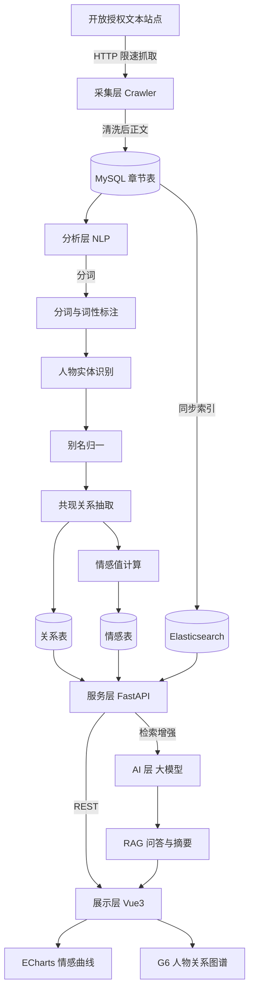

# 架构设计

## 分层架构

| 层 | 职责 | 技术选型 |
|---|---|---|
| 采集层 | 抓取、清洗、增量更新 | Scrapy + BeautifulSoup |
| 分析层 | 分词、实体识别、关系抽取、情感计算 | HanLP + jieba + NetworkX |
| 服务层 | 业务逻辑、REST 接口 | FastAPI + SQLAlchemy |
| 存储层 | 持久化与全文检索 | MySQL 8 + Elasticsearch |
| 展示层 | 页面与可视化 | Vue 3 + ECharts + AntV G6 |
| AI 层 | 摘要、人物小传、RAG 问答 | 大模型 API |

## 架构图

## 关键数据流

1. **采集流**：站点 → robots 校验 → 限速抓取 → 正文抽取 → 章节切分 → 入库
2. **分析流**：章节正文 → 分词 → 实体识别 → 别名归一 → 共现统计 → 关系表
3. **问答流**：用户提问 → 向量/关键词检索原文 → 组装证据 → 大模型生成 → 附出处返回

## 关键决策记录（ADR）

| 编号 | 决策 | 理由 | 备选方案 |
|---|---|---|---|
| ADR-001 | 后端采用 Python/FastAPI | 中文 NLP 与图分析生态成熟，与分析层技术栈统一 | Java / Spring Boot |
| ADR-002 | 关系抽取采用共现统计而非依存句法 | 依存句法在古文上准确率低且性能开销大 | 依存句法分析 |
| ADR-003 | 采用 RAG 而非直接问答 | 避免模型幻觉，答案可溯源至原文 | 直接调用大模型 |
| ADR-004 | 仅采集公有领域与开放授权文本 | 规避版权风险，工程合规 | 不限来源 |
| ADR-005 | 存储采用 MySQL + Elasticsearch 双写 | 关系查询与全文检索诉求不同，单一存储难以兼顾 | 仅用 MySQL |
