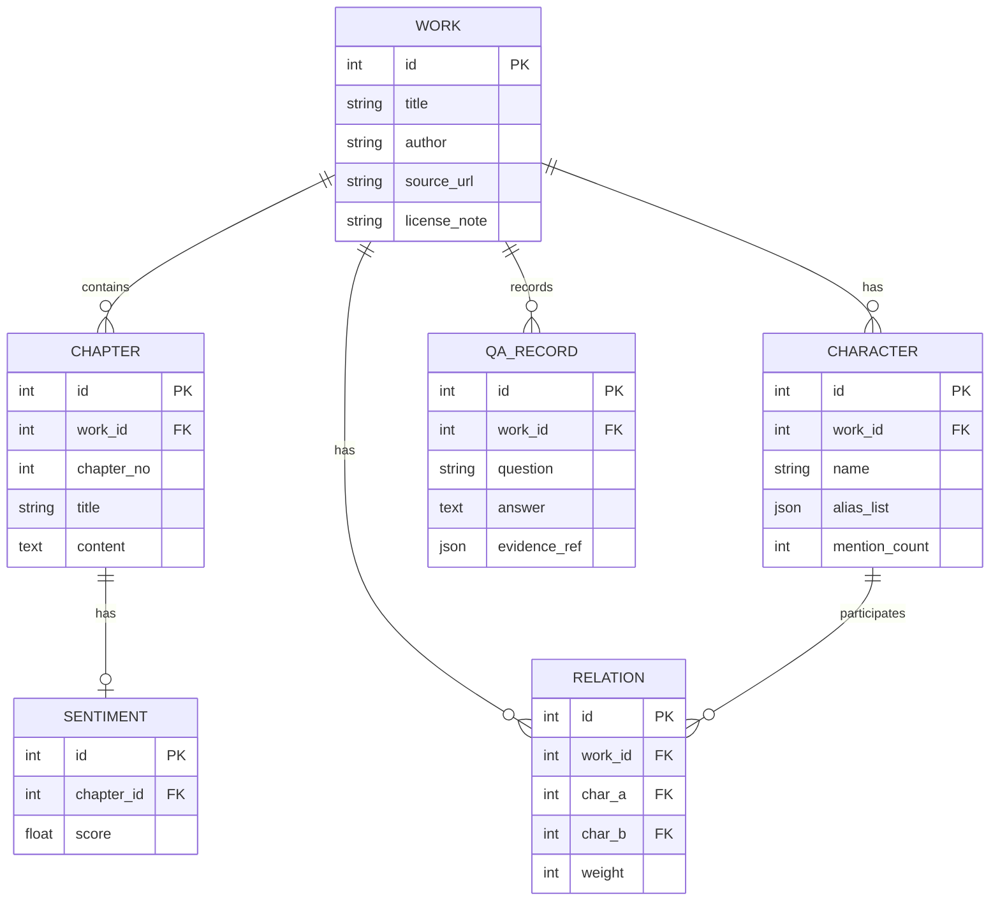

# 数据模型

## ER 图

## 实体说明

| 实体 | 说明 | 关键约束 |
|---|---|---|
| Work | 作品元信息与授权说明 | source_url 唯一，避免重复采集 |
| Chapter | 章节正文与序号 | (work_id, chapter_no) 联合唯一 |
| Character | 人物实体及别名字典 | (work_id, name) 联合唯一 |
| Relation | 人物共现关系及权重 | (work_id, char_a, char_b) 联合唯一 |
| Sentiment | 章节情感值序列 | 每章节一条 |
| QaRecord | 问答记录与溯源引用 | evidence_ref 记录章节定位 |
